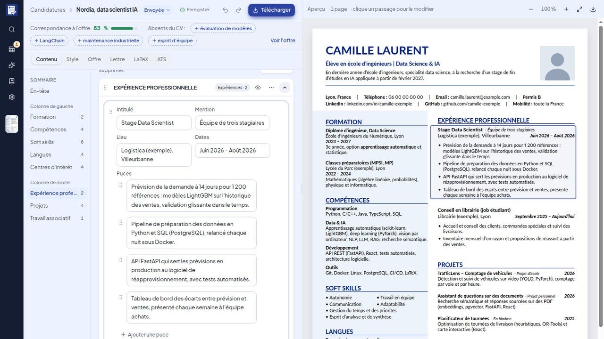
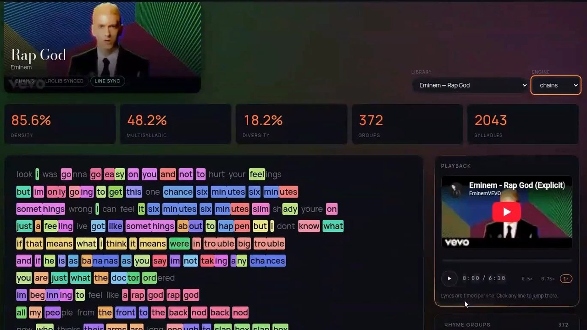
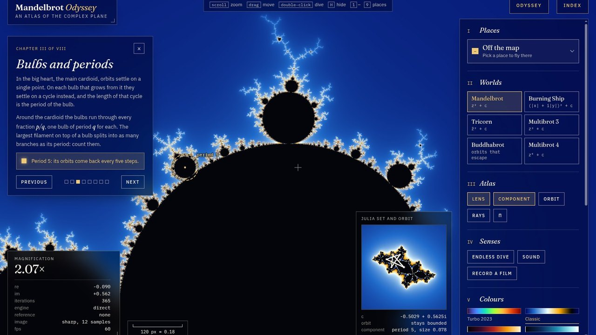
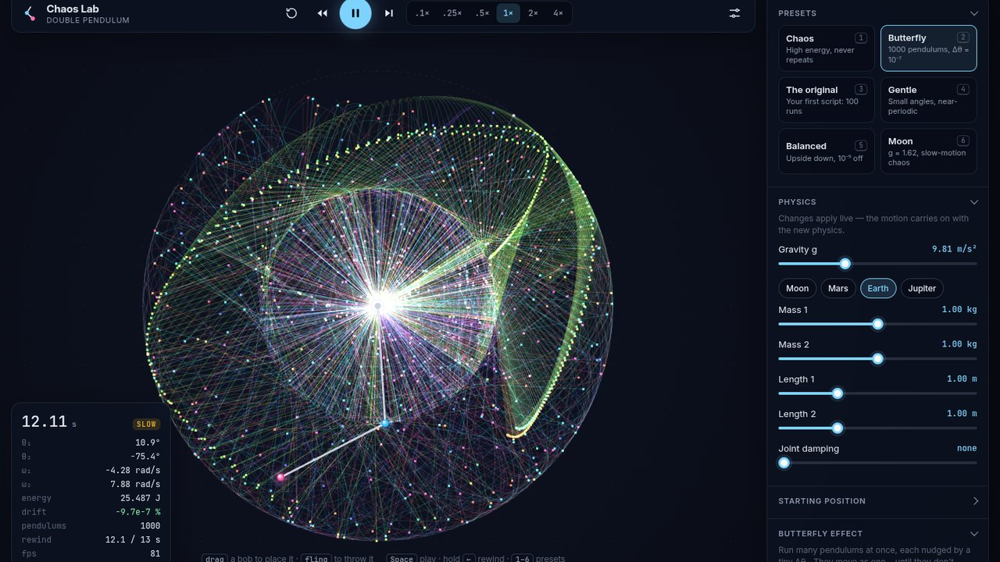
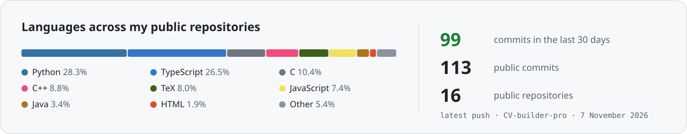

<!-- This file is generated every night by scripts/build.mjs from template.md: edit the template. -->

<picture>
  <source media="(prefers-color-scheme: dark)" srcset="assets/banner-dark.svg">
  
</picture>

<p align="center">
  <a href="https://www.linkedin.com/in/yahya-bel-hajjam"></a>
  
  
</p>

```python
yahya = {
    "studies":   "Data Science & AI engineering, ENSEIRB-MATMECA",
    "ai":        ["LLM apps", "RAG", "local models", "speech to text"],
    "data":      ["pipelines", "vector search", "analytics", "machine learning"],
    "software":  ["full-stack web", "GPU graphics", "systems in C", "compilers"],
    "off_hours": ["GPU fractals", "chaos simulations", "rap rhyme maps"],
    "ask_me":    "why your retrieval finds the wrong document",
}
```

## Featured projects

<table>
  <tr>
    <td width="50%" valign="top">
      <a href="https://github.com/yahyabmo/CV-builder-pro"></a>
      <h3><a href="https://github.com/yahyabmo/CV-builder-pro">CV Builder Pro</a> <sub>★ 0</sub></h3>
      A local tool that writes a LaTeX CV <b>targeted at each job offer</b>: a visual editor with live PDF preview, import of an existing PDF CV, an ATS keyword score, cover letters and application tracking. Runs with a local LLM (Ollama) or Gemini.
      <br><br>
          
    </td>
    <td width="50%" valign="top">
      <a href="https://github.com/yahyabmo/RhymeMap"></a>
      <h3><a href="https://github.com/yahyabmo/RhymeMap">RhymeMap</a> <sub>★ 0</sub></h3>
      Rap lyrics, read by their <b>sound</b>: RhymeMap splits words into syllables, compares their phonetics and colors every rhyme, multisyllabic ones included, to show the architecture of a verse. Then it compares artists by their rhyme density and style.
      <br><br>
         
    </td>
  </tr>
  <tr>
    <td width="50%" valign="top">
      <a href="https://github.com/yahyabmo/the-mandelbrot-set"></a>
      <h3><a href="https://github.com/yahyabmo/the-mandelbrot-set">Mandelbrot Odyssey</a> <sub>★ 1</sub></h3>
      A real-time explorer of the Mandelbrot set that zooms smoothly <b>down to 10<sup>300</sup></b>, past the limits of floating point: perturbation theory on the GPU, a reference orbit of up to 1,030 bits, an endless dive, an atlas of Julia sets, and films exported in the browser.
      <br><br>
         
    </td>
    <td width="50%" valign="top">
      <a href="https://github.com/yahyabmo/the-double-pendulum"></a>
      <h3><a href="https://github.com/yahyabmo/the-double-pendulum">Chaos Lab</a> <sub>★ 1</sub></h3>
      The butterfly effect you can touch: a double pendulum simulator whose equations are <b>derived from the Lagrangian with SymPy</b> and integrated with RK4. Throw the bobs, change gravity, rewind time, or start 2,000 pendulums a ten-millionth of a radian apart.
      <br><br>
         
    </td>
  </tr>
</table>

<details>
<summary><b>More things I've built</b></summary>
<br>

| Project | What it is | Built with |
| --- | --- | --- |
| [hackathon-IA](https://github.com/yahyabmo/hackathon-IA) | A local, explainable banking assistant: for each message, a router picks the smallest tool that is enough (rules, a small LLM, sourced fact sheets). La Banque Postale × CGI × ENSEIRB-MATMECA hackathon. | Python, FastAPI, Ollama |
| [Continuum](https://github.com/yahyabmo/Continuum) | Turns a short phone video into an object you look at in the browser, with time as the third dimension. In progress. | Python |
| [coursidor](https://github.com/yahyabmo/coursidor) | A strategy game inspired by Quoridor, with a server–client architecture where player strategies load as dynamic modules. | C |
| [Eirbone](https://github.com/yahyabmo/Eirbone) | Peer-to-peer exchange of large files. | C, Java |
| [algorithmique_numerique](https://github.com/yahyabmo/algorithmique_numerique) | Projects of the numerical algorithms course at ENSEIRB-MATMECA, starting with the limits of machine arithmetic. | Python |
| [projet_compilation](https://github.com/yahyabmo/projet_compilation) | A compiler from the Myc language to P-code. | C |
| [user-thread-library](https://github.com/yahyabmo/user-thread-library) | A user-level thread library. | C |
| [RhymeMapper](https://github.com/yahyabmo/RhymeMapper) | The first version of RhymeMap: phonetic rhyme analysis in the terminal, and its [web visualization](https://yahyabmo.github.io/). | Python, JavaScript |

</details>

## Toolbox

<p>
  
</p>
<p>
  
</p>
<p>
  
</p>
<p>
  
  
  
  
  
  
  
  
  
  
  
  
</p>

## Fractal of the day


<p align="center"><sub>
  <b>2026-11-09</b> · c = -0.7479575863 + 0.0667687431 i · magnified 69,338 times · 5,406 iterations · Orchid palette<br>
  A new place on the edge of the set every night, found and rendered by this repository's GitHub Action.
  Explore it in <a href="https://github.com/yahyabmo/the-mandelbrot-set">Mandelbrot Odyssey</a>: once installed, <a href="http://localhost:5191/#re=-0.7479575863&im=0.0667687431&w=4.326639e-5">open this view</a>.
</sub></p>

## By the numbers

<picture>
  <source media="(prefers-color-scheme: dark)" srcset="assets/stats-dark.svg">
  
</picture>

---

<p align="center"><sub>
  This README rebuilds itself every night: a new fractal and fresh numbers, by <a href=".github/workflows/refresh.yml">a GitHub Action</a> and <a href="scripts">plain Node.js</a>.<br>
  Last build: 2026-11-09 at 14:20 UTC
</sub></p>
